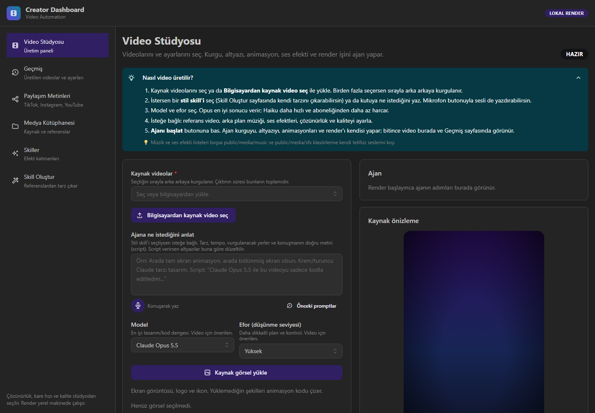
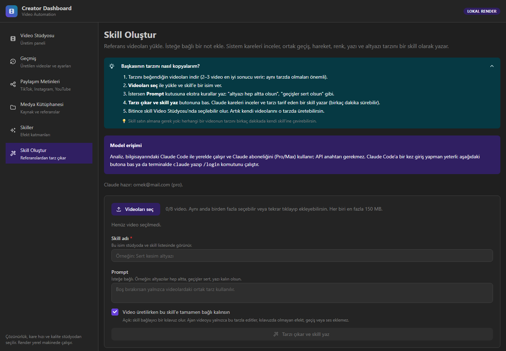
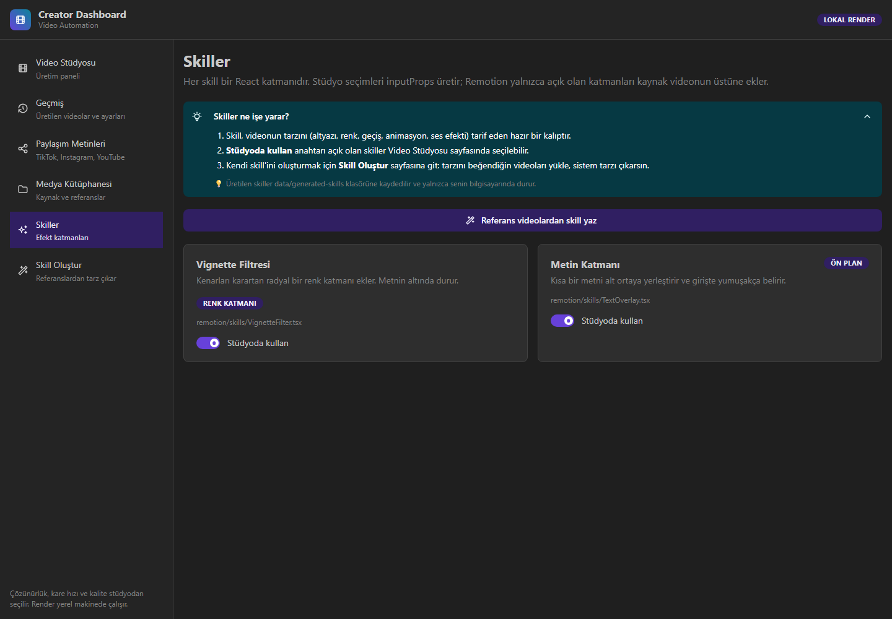
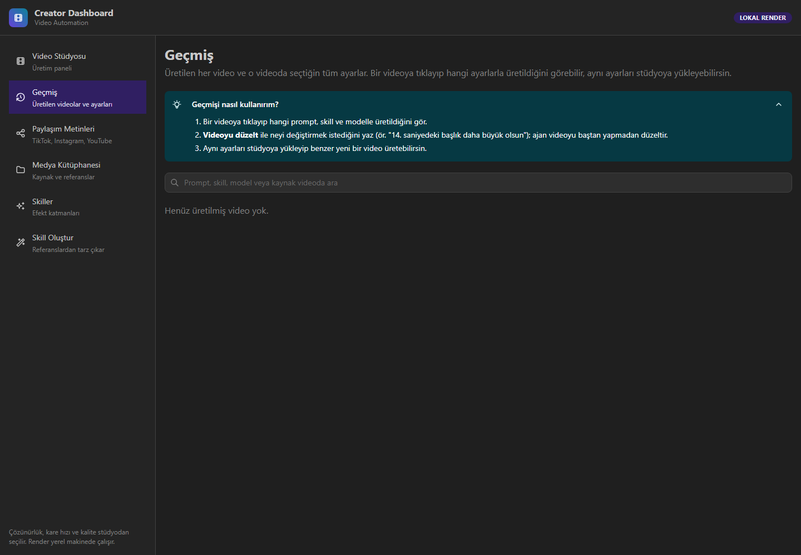
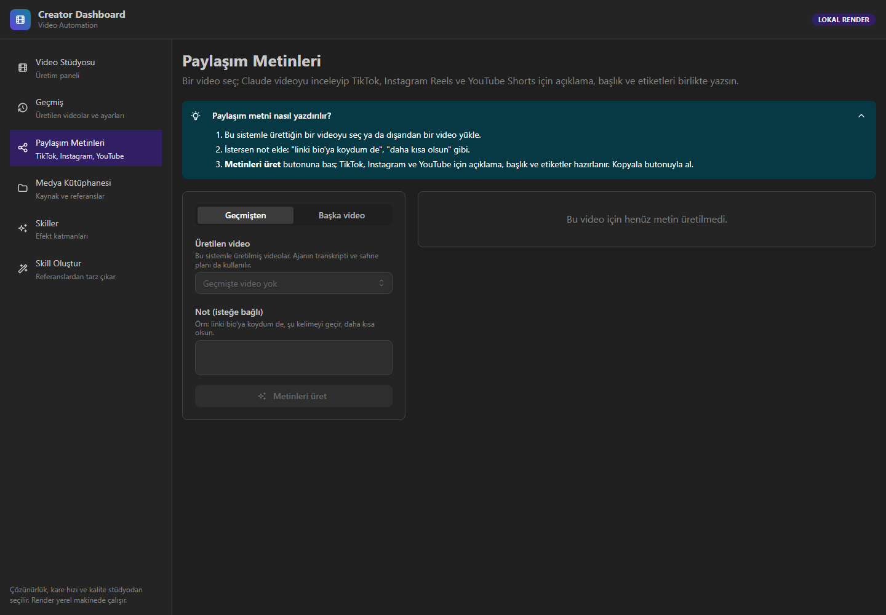
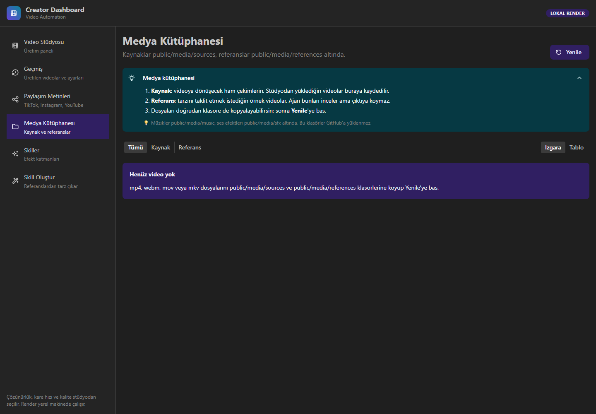

<a id="turkce"></a>

**🇹🇷 Türkçe** · [🇬🇧 English](#english)

> 🇬🇧 **For English, please scroll down** or click [here](#english).

# 🎬 Video Automation: Kendi Skill'ini Kendin Oluştur

Bilgisayarında çalışan, **Claude Code** destekli bir kısa video (Reels / TikTok / Shorts) üretim paneli.

> **Claude skill'leri için para vermene gerek yok.** Beğendiğin bir videoyu indir, sisteme yükle.
> Sistem videonun tarzını (altyazı, renk, geçiş, animasyon, ses efekti) inceler ve **sana özel bir skill** yazar.
> Sonra kendi çekimlerini o tarzda, tek tıkla videoya dönüştürürsün.



---

## İçindekiler

1. [Ne işe yarar?](#-ne-işe-yarar)
2. [Gereken programlar](#-gereken-programlar)
3. [Adım adım kurulum](#%EF%B8%8F-adım-adım-kurulum)
4. [Projeyi çalıştırma](#%EF%B8%8F-projeyi-çalıştırma)
5. [Sayfalar ve ne işe yaradıkları](#%EF%B8%8F-sayfalar-ve-ne-işe-yaradıkları)
6. [İlk videonu üret (hızlı başlangıç)](#-i̇lk-videonu-üret-hızlı-başlangıç)
7. [Müzik ve ses efektlerini ekleme](#-müzik-ve-ses-efektlerini-ekleme)
8. [Ayarlar (.env.local)](#%EF%B8%8F-ayarlar-envlocal)
9. [Sık karşılaşılan sorunlar](#-sık-karşılaşılan-sorunlar)
10. [Klasör yapısı](#%EF%B8%8F-klasör-yapısı)

---

## ✨ Ne işe yarar?

| Özellik | Açıklama |
| --- | --- |
| 🪄 **Skill oluşturma** | Tarzını beğendiğin videoları yükle, sistem o tarzı tarif eden bir skill yazsın. |
| 🎞️ **Otomatik kurgu** | Ham çekimlerini ver, ne istediğini yaz. Kesme, altyazı, animasyon, ses efekti ve müziği ajan kendisi ekler. |
| 🗣️ **Kelime kelime altyazı** | Konuşmalar bilgisayarında (internetsiz) yazıya dökülür, altyazılar sese tam oturur. |
| 🔁 **Düzeltme** | "14. saniyedeki başlık büyük olsun" gibi bir not yaz; video baştan yapılmadan düzeltilir. |
| 📱 **Paylaşım metinleri** | TikTok, Instagram ve YouTube için açıklama, başlık ve etiketleri hazırlar. |
| 💸 **API ücreti yok** | Her şey Claude aboneliğin (Pro / Max) üzerinden çalışır. API anahtarı gerekmez. |

> [!NOTE]
> Her şey **senin bilgisayarında** çalışır. Videoların, skill'lerin ve geçmişin hiçbir sunucuya yüklenmez
> (yalnızca analiz için Claude'a gönderilen kareler ve metinler hariç).

---

## 🧰 Gereken programlar

| Program | Zorunlu mu? | Ne için? |
| --- | --- | --- |
| **Node.js 20.9 veya üstü** (LTS önerilir) | ✅ Evet | Paneli ve video render'ını çalıştırır. |
| **Claude Code** + **Claude Pro / Max aboneliği** | ✅ Evet | Videoyu kurgulayan ve skill yazan yapay zekâ ajanı. |
| **Git** | ⚪ İsteğe bağlı | Projeyi indirmek için. İstersen ZIP olarak da indirebilirsin. |
| **Python 3.10 veya üstü** | 🟡 Önerilir | Konuşmayı yazıya dökmek (altyazı), mikrofonla yazdırma ve müzik ritmi analizi. |

> [!TIP]
> **ffmpeg** kurmana gerek yok, proje kendi ffmpeg'ini getirir. Render için gereken tarayıcı da ilk render'da
> otomatik indirilir.

---

## 🛠️ Adım adım kurulum

> Yazılım bilmiyorsan endişelenme. Komutları **kopyala, yapıştır, Enter'a bas** yeterli.
> Windows'ta komutlar için **PowerShell** kullan: Başlat menüsüne `PowerShell` yaz ve aç.
> Mac'te **Terminal** uygulamasını aç.

### 1. Node.js'i kur

**Windows:**

1. [nodejs.org](https://nodejs.org/) adresine git ve **LTS** yazan büyük yeşil butona tıkla.
2. İnen `.msi` dosyasını aç. Her ekranda **Next** de, en sonda **Install**'a bas.
3. Kurulum bitince PowerShell'i **kapatıp yeniden aç**.

Ya da PowerShell'den tek komutla kurabilirsin:

```powershell
winget install OpenJS.NodeJS.LTS
```

**Mac:** [nodejs.org](https://nodejs.org/) adresinden **LTS** sürümünün `.pkg` dosyasını indirip kur. Homebrew kullanıyorsan `brew install node` da olur.

**Kontrol et:** Aşağıdaki komut `v20` ya da daha yüksek bir sürüm yazmalı.

```powershell
node -v
```

### 2. Claude Code'u kur ve giriş yap

Claude Code, Anthropic'in resmi komut satırı aracıdır. Bu proje videoları onunla üretir.

**Windows (PowerShell):**

```powershell
irm https://claude.ai/install.ps1 | iex
```

**Mac / Linux (Terminal):**

```bash
curl -fsSL https://claude.ai/install.sh | bash
```

Kurulumdan sonra terminali kapatıp yeniden aç ve giriş yap:

```powershell
claude
```

Açılan ekranda `/login` yaz. **Claude.ai hesabı (Pro / Max abonelik)** seçeneğini seç ve tarayıcıda giriş yap.
Giriş yaptıktan sonra `/exit` yazıp çıkabilirsin. Bu işlemi bir kez yapman yeterli.

> [!IMPORTANT]
> Girişte **"Anthropic Console"** değil, **"Claude.ai hesabı"** seçeneğini seç. Böylece harcama aboneliğinden gider, ekstra ücret çıkmaz.

### 3. Python'u kur (önerilir)

Altyazıların sese tam oturması ve mikrofonla yazdırma özelliği için gerekir.

**Windows:** [python.org/downloads](https://www.python.org/downloads/) adresinden en son sürümü indir.
Kurulumun **ilk ekranında en alttaki "Add python.exe to PATH" kutusunu mutlaka işaretle**, sonra **Install Now**'a bas.

Ya da:

```powershell
winget install Python.Python.3.12
```

**Mac:** `brew install python` ya da python.org'dan indir.

**Kontrol et:**

```powershell
python --version
```

### 4. Projeyi indir

**Git ile:**

```powershell
git clone https://github.com/Yigit-Yeler/claude-video-studio.git
```

```powershell
cd claude-video-studio
```

**Git yoksa:** GitHub sayfasında yeşil **Code** butonuna, sonra **Download ZIP**'e bas. ZIP'i bir klasöre çıkar.
PowerShell'de o klasöre gir (ör. `cd C:\Users\Adın\Desktop\claude-video-studio-main`).

### 5. Paketleri yükle

Proje klasörünün içindeyken:

```powershell
npm install
```

Birkaç dakika sürebilir. Sarı `warn` yazıları normaldir.

Python kurduysan altyazı araçlarını da yükle:

```powershell
pip install -r scripts/video-tools/requirements.txt
```

> [!NOTE]
> İlk altyazı işleminde konuşma tanıma modeli (~1,5 GB) bir kez indirilir. Ekran kartın (NVIDIA) varsa otomatik
> olarak onu kullanır, yoksa işlemciyle çalışır.

---

## ▶️ Projeyi çalıştırma

Proje klasöründe:

```powershell
npm run dev
```

`Ready` yazısını görünce tarayıcıda **http://localhost:3000** adresini aç. İşte bu kadar! 🎉

- Paneli kapatmak için terminalde `Ctrl + C` yap.
- Bir sonraki sefer sadece proje klasörüne girip `npm run dev` yazman yeterli.

---

## 🗺️ Sayfalar ve ne işe yaradıkları

Her sayfanın üstünde **💡 bilgilendirme kartı** var. Ne yapman gerektiğini adım adım anlatır.
Okuduktan sonra ok işaretiyle kapatabilirsin, kapalı kaldığı hatırlanır.

### 🎬 Video Stüdyosu (`/`)

Videoların üretildiği ana sayfa. Kaynak videolarını seçersin, ne istediğini yazarsın (ya da bir skill seçersin),
**Ajanı başlat**'a basarsın. Sağ tarafta ajanın ne yaptığını canlı izlersin. Video bitince önizleyip **MP4 indir**'e basabilirsin.

- **Kaynak videolar:** Videoya dönüşecek ham çekimlerin. Birden fazla seçersen sırayla birleştirilir.
- **Ajana ne istediğini anlat:** Tarz, tempo, vurgular. Konuşmanın doğru metnini (script) yazarsan altyazılar ona göre düzeltilir. 🎤 butonuyla sesli de yazdırabilirsin.
- **Model / Efor:** Opus en iyi sonucu verir. Haiku daha hızlıdır ve aboneliğinden daha az harcar.
- **Kaynak görsel:** Videoda gösterilmesini istediğin ekran görüntüsü, logo ve ikonlar.
- **Referans videolar:** Tarzı taklit edilecek örnekler. Çıktıya konmaz, sadece incelenir.
- **Arka plan müziği / Ses efektleri:** Kendi kütüphanenden seçilir (aşağıya bak).
- **Çözünürlük, kare hızı, kalite:** Varsayılan 1080×1920 (dikey), 30 fps.

### 🪄 Skill Oluştur (`/skills/create`)



Projenin en önemli özelliği. **Başkasının video tarzını kopyalamak için:**

1. Tarzını beğendiğin 2–3 videoyu indir. Aynı tarzda olmaları önemli.
2. **Videoları seç** ile yükle (en fazla 8 video, her biri en fazla 150 MB).
3. Skill'e bir isim ver. İstersen **Prompt** kutusuna ekstra kurallar yaz ("altyazı hep altta olsun" gibi).
4. **Tarzı çıkar ve skill yaz**'a bas. Claude kareleri inceler ve tarzı tarif eden bir skill yazar.
5. Skill artık Video Stüdyosu'nda seçilebilir. Kendi videolarını o tarzda üret!

> [!TIP]
> **"Video üretilirken bu skill'e tamamen bağlı kalınsın"** açıkken ajan sadece skill'deki tarzı kullanır.
> Kapalıyken skill'i bir ilham kaynağı gibi kullanır ve kendi fikirlerini de ekler.

### ✨ Skiller (`/skills`)



Tüm skill'lerin listesi. **Stüdyoda kullan** anahtarıyla hangilerinin stüdyoda görüneceğini seçersin.
Proje boş gelir: skill'leri sen oluşturursun.

### 🕘 Geçmiş (`/history`)



Ürettiğin her video ve o videonun tüm ayarları (prompt, skill, model, süre, harcanan token).

- **Videoyu düzelt:** Neyi değiştirmek istediğini yaz, ajan videoyu düzeltsin.
- **Bu ayarları stüdyoya yükle:** Aynı ayarlarla yeni bir video üret.

### 📱 Paylaşım Metinleri (`/social`)



Ürettiğin ya da dışarıdan yüklediğin bir video için **TikTok, Instagram Reels ve YouTube Shorts** metinlerini yazar:
açıklama, başlık, hashtag, kapak yazısı ve ilk yorum. Tek tuşla kopyalarsın.

### 📁 Medya Kütüphanesi (`/media`)



Yüklediğin kaynak ve referans videoların listesi. Videoları doğrudan klasöre kopyalayıp **Yenile**'ye de basabilirsin.

---

## 🚀 İlk videonu üret (hızlı başlangıç)

1. `npm run dev` ile paneli aç → **http://localhost:3000**
2. **Skill Oluştur** sayfasına git, tarzını beğendiğin 2–3 videoyu yükle, bir isim ver ve skill'i oluştur. *(İstersen bu adımı atlayıp sadece yazarak da video üretebilirsin.)*
3. **Video Stüdyosu**'na dön. **Bilgisayardan kaynak video seç** ile kendi çekimini yükle.
4. Skill listesinden yeni skill'ini seç. İstersen kutuya ek isteklerini yaz.
5. **Ajanı başlat**'a bas ve bekle. Süre videonun uzunluğuna ve seçtiğin modele göre birkaç dakika ile yarım saat arası değişir.
6. Video hazır olunca **MP4 indir**. Paylaşım metinleri için **Paylaşım Metinleri** sayfasına geç.

---

## 🎵 Müzik ve ses efektlerini ekleme

Telif sorunu olmaması için proje **müzik ve ses efekti olmadan** gelir. Kendi seslerini şu klasörlere koy:

| Klasör | Ne koymalı? |
| --- | --- |
| `public/media/music/` | Arka plan müzikleri (`.mp3`, `.wav`, `.m4a`...) |
| `public/media/sfx/` | Ses efektleri. Alt klasör adı kategoridir: `whoosh`, `click`, `pop`, `money`, `notification`... |

- Dosya adlarını **açıklayıcı** ver (`whoosh-yumusak.mp3`, `kasa-sesi.mp3`). Ajan sesleri duyamaz, ne olduklarını adından anlar.
- Ayrıntılar: [`public/media/sfx/OKUBENI.md`](public/media/sfx/OKUBENI.md)
- Telifsiz ses kaynakları: [Pixabay Sound Effects](https://pixabay.com/sound-effects/), [Mixkit](https://mixkit.co/free-sound-effects/), [Freesound](https://freesound.org/) (CC0 filtresiyle).

> [!WARNING]
> Paylaşacağın videolarda yalnızca **kullanım hakkın olan** müzik ve sesleri kullan. Popüler şarkılar
> Instagram / YouTube'da telif uyarısına ya da sesin kapatılmasına yol açabilir.

Müzik ve ses efektlerini stüdyodaki **Arka plan müziği yükle** ve ses efekti alanından da yükleyebilirsin.

---

## ⚙️ Ayarlar (.env.local)

Hiçbir ayar zorunlu değil. Değiştirmek istersen `.env.example` dosyasını kopyalayıp adını `.env.local` yap:

| Değişken | Ne işe yarar? |
| --- | --- |
| `VIDEO_AGENT_MODEL` | Panelde seçim yapılmadığında kullanılacak model (ör. `claude-opus-5-5`). |
| `VIDEO_AGENT_EFFORT` | Varsayılan efor: `low`, `medium`, `high`, `xhigh`, `max`. |
| `CLAUDE_CODE_PATH` | `claude` bulunamazsa tam yolu (ör. `C:\Users\Adın\.local\bin\claude.exe`). |
| `VIDEO_PYTHON` | Python'un adı ya da tam yolu (varsayılan: Windows'ta `python`, diğerlerinde `python3`). |
| `VIDEO_AGENT_LEAN` | `0` yaparsan ajan senin MCP sunucularını ve skill'lerini de yükler (daha çok token harcar). |

> [!CAUTION]
> `.env.local` dosyasını **asla** GitHub'a yükleme. `.gitignore` bunu zaten engeller.

---

## 🩺 Sık karşılaşılan sorunlar

<details>
<summary><b>"Claude Code hazır değil" uyarısı çıkıyor</b></summary>

Terminalde `claude` yaz ve `/login` ile **Claude.ai hesabınla** giriş yap. Sonra paneldeki **Tekrar kontrol et**'e bas.
Hâlâ olmuyorsa `.env.local` içine `CLAUDE_CODE_PATH=...` ile `claude.exe`'nin tam yolunu yaz.
</details>

<details>
<summary><b><code>npm</code> / <code>node</code> tanınmıyor</b></summary>

Node.js kurduktan sonra terminali (PowerShell) kapatıp yeniden aç. Olmazsa bilgisayarı yeniden başlat.
</details>

<details>
<summary><b>"faster_whisper kurulu değil" hatası</b></summary>

Python'u kurup şu komutu çalıştır:

```powershell
pip install -r scripts/video-tools/requirements.txt
```

Birden fazla Python varsa `.env.local` içine `VIDEO_PYTHON=C:\...\python.exe` yaz.
</details>

<details>
<summary><b>Abonelik limiti doldu, video yarıda kaldı</b></summary>

Limit sıfırlanınca stüdyodaki **Devam et** butonuna bas. Ajan kaldığı yerden devam eder.
Daha az harcamak için **Haiku** ya da **Sonnet** modelini ve daha düşük bir efor seviyesi seç.
</details>

<details>
<summary><b>Model listesinde Opus / Haiku görünmüyor</b></summary>

Claude Code'u güncelle:

```powershell
claude update
```

</details>

<details>
<summary><b>3000 portu kullanımda</b></summary>

Başka bir uygulama 3000 portunu kullanıyor. Onu kapat ya da `npm run dev -- -p 3001` ile başlatıp
**http://localhost:3001** adresini aç.
</details>

---

## 🗂️ Klasör yapısı

```text
app/                      Sayfalar ve API uçları (Next.js)
components/ui/            Panel bileşenleri
lib/                      Video ajanı, skill yazarı, render işleri
remotion/                 Video şablonları (Remotion)
  skills/generated/       Oluşturduğun skill'lerin kodu (otomatik)
scripts/video-tools/      ffmpeg ve Python yardımcıları (kesme, altyazı, ritim)
data/
  generated-skills/       Oluşturduğun skill'ler (otomatik)
  render-history/         Üretilen videoların kayıtları (otomatik)
public/media/
  sources/                Kaynak videoların
  references/             Referans videoların
  assets/                 Görseller (ekran görüntüsü, logo)
  music/                  Müziklerin
  sfx/                    Ses efektlerin
```

Bu klasörlerdeki kişisel dosyaların (videolar, skill'ler, müzikler, geçmiş) **git'e eklenmez**.
Projeyi fork'layıp değişiklik gönderirsen kendi içeriğin yanlışlıkla paylaşılmaz.

---

## 🧱 Kullanılan teknolojiler

[Next.js](https://nextjs.org) · [Remotion](https://www.remotion.dev) · [Mantine](https://mantine.dev) ·
[Claude Code](https://claude.com/claude-code) · [faster-whisper](https://github.com/SYSTRAN/faster-whisper) · ffmpeg

> [!NOTE]
> Remotion, şirketler için ücretli bir lisans gerektirebilir. Bireysel kullanım ve küçük ekipler için ücretsizdir.
> Ayrıntılar: [remotion.dev/license](https://www.remotion.dev/license)

---
---

<a id="english"></a>

[🇹🇷 Türkçe](#turkce) · **🇬🇧 English**

# 🎬 Video Automation: Build Your Own Skills

A short-form video (Reels / TikTok / Shorts) production dashboard that runs on your own computer, powered by **Claude Code**.

> **You don't need to pay for Claude skills.** Download a video you like and upload it to the app.
> The app studies the video's style (captions, colors, transitions, animations, sound effects) and writes **a skill made for you**.
> Then you turn your own footage into a video in that style with one click.

> [!NOTE]
> The app's interface is in **Turkish**. In this guide, button and page names are given in Turkish first,
> with the English meaning in parentheses, so you can find them on screen.


---

## Table of contents

1. [What does it do?](#-what-does-it-do)
2. [Required software](#-required-software)
3. [Step-by-step installation](#%EF%B8%8F-step-by-step-installation)
4. [Running the project](#%EF%B8%8F-running-the-project)
5. [Pages and what they do](#%EF%B8%8F-pages-and-what-they-do)
6. [Make your first video (quick start)](#-make-your-first-video-quick-start)
7. [Adding music and sound effects](#-adding-music-and-sound-effects)
8. [Settings (.env.local)](#%EF%B8%8F-settings-envlocal)
9. [Troubleshooting](#-troubleshooting)
10. [Folder structure](#%EF%B8%8F-folder-structure)

---

## ✨ What does it do?

| Feature | Description |
| --- | --- |
| 🪄 **Skill creation** | Upload videos whose style you like, and the app writes a skill that describes that style. |
| 🎞️ **Automatic editing** | Give it your raw footage and say what you want. The agent adds cuts, captions, animations, sound effects and music on its own. |
| 🗣️ **Word-by-word captions** | Speech is transcribed on your computer (offline), so captions match the audio exactly. |
| 🔁 **Revisions** | Write a note like "make the title at 0:14 bigger"; the video is fixed without starting over. |
| 📱 **Social media copy** | Writes descriptions, titles and hashtags for TikTok, Instagram and YouTube. |
| 💸 **No API costs** | Everything runs on your Claude subscription (Pro / Max). No API key needed. |

> [!NOTE]
> Everything runs **on your computer**. Your videos, skills and history are never uploaded to a server
> (except the frames and text sent to Claude for analysis).

---

## 🧰 Required software

| Software | Required? | What for? |
| --- | --- | --- |
| **Node.js 20.9 or newer** (LTS recommended) | ✅ Yes | Runs the dashboard and video rendering. |
| **Claude Code** + **Claude Pro / Max subscription** | ✅ Yes | The AI agent that edits videos and writes skills. |
| **Git** | ⚪ Optional | To download the project. You can also download it as a ZIP. |
| **Python 3.10 or newer** | 🟡 Recommended | Speech-to-text (captions), voice dictation and music beat analysis. |

> [!TIP]
> You don't need to install **ffmpeg**; the project ships its own. The browser needed for rendering is also
> downloaded automatically on your first render.

---

## 🛠️ Step-by-step installation

> Don't worry if you can't code. **Copy, paste and press Enter** is all you need.
> On Windows, use **PowerShell** for commands: type `PowerShell` in the Start menu and open it.
> On Mac, open the **Terminal** app.

### 1. Install Node.js

**Windows:**

1. Go to [nodejs.org](https://nodejs.org/) and click the big green **LTS** button.
2. Open the downloaded `.msi` file. Click **Next** on every screen, then **Install** at the end.
3. When it's done, **close and reopen** PowerShell.

Or install it with one command in PowerShell:

```powershell
winget install OpenJS.NodeJS.LTS
```

**Mac:** Download and install the **LTS** `.pkg` file from [nodejs.org](https://nodejs.org/). If you use Homebrew, `brew install node` works too.

**Check:** The command below should print `v20` or higher.

```powershell
node -v
```

### 2. Install Claude Code and sign in

Claude Code is Anthropic's official command-line tool. This project uses it to make videos.

**Windows (PowerShell):**

```powershell
irm https://claude.ai/install.ps1 | iex
```

**Mac / Linux (Terminal):**

```bash
curl -fsSL https://claude.ai/install.sh | bash
```

After installing, close and reopen your terminal, then sign in:

```powershell
claude
```

Type `/login` on the screen that opens. Choose **Claude.ai account (Pro / Max subscription)** and sign in in your browser.
Once you're signed in, type `/exit` to leave. You only need to do this once.

> [!IMPORTANT]
> When signing in, choose **"Claude.ai account"**, not **"Anthropic Console"**. That way usage comes from your subscription with no extra charges.

### 3. Install Python (recommended)

Needed for captions that match the audio exactly and for voice dictation.

**Windows:** Download the latest version from [python.org/downloads](https://www.python.org/downloads/).
On the **first screen of the installer, make sure to tick "Add python.exe to PATH" at the bottom**, then click **Install Now**.

Or:

```powershell
winget install Python.Python.3.12
```

**Mac:** `brew install python`, or download it from python.org.

**Check:**

```powershell
python --version
```

### 4. Download the project

**With Git:**

```powershell
git clone https://github.com/Yigit-Yeler/claude-video-studio.git
```

```powershell
cd claude-video-studio
```

**Without Git:** On the GitHub page, click the green **Code** button, then **Download ZIP**. Extract the ZIP into a folder.
In PowerShell, go into that folder (e.g. `cd C:\Users\YourName\Desktop\claude-video-studio-main`).

### 5. Install the packages

From inside the project folder:

```powershell
npm install
```

This can take a few minutes. Yellow `warn` messages are normal.

If you installed Python, install the caption tools too:

```powershell
pip install -r scripts/video-tools/requirements.txt
```

> [!NOTE]
> The speech recognition model (~1.5 GB) is downloaded once, the first time captions are made. If you have an
> NVIDIA graphics card it is used automatically; otherwise it runs on the CPU.

---

## ▶️ Running the project

In the project folder:

```powershell
npm run dev
```

When you see `Ready`, open **http://localhost:3000** in your browser. That's it! 🎉

- To stop the dashboard, press `Ctrl + C` in the terminal.
- Next time, just go into the project folder and type `npm run dev`.

---

## 🗺️ Pages and what they do

Every page has a **💡 info card** at the top that explains what to do, step by step.
Once you've read it, you can collapse it with the arrow; it stays collapsed.

### 🎬 Video Stüdyosu (Video Studio) (`/`)

The main page where videos are made. Pick your source videos, describe what you want (or choose a skill),
and press **Ajanı başlat** (Start agent). Watch what the agent does live on the right. When the video is done, preview it and press **MP4 indir** (Download MP4).

- **Kaynak videolar (Source videos):** Your raw footage to be turned into a video. If you pick more than one, they're joined in order.
- **Ajana ne istediğini anlat (Tell the agent what you want):** Style, pacing, highlights. If you write the exact script of the speech, captions are corrected to match it. You can also dictate with the 🎤 button.
- **Model / Efor (Model / Effort):** Opus gives the best results. Haiku is faster and uses less of your subscription.
- **Kaynak görsel (Source images):** Screenshots, logos and icons you want shown in the video.
- **Referans videolar (Reference videos):** Examples whose style is imitated. They're only studied, never put in the output.
- **Arka plan müziği / Ses efektleri (Background music / Sound effects):** Chosen from your own library (see below).
- **Çözünürlük, kare hızı, kalite (Resolution, frame rate, quality):** Default is 1080×1920 (vertical), 30 fps.

### 🪄 Skill Oluştur (Create Skill) (`/skills/create`)


The most important feature of the project. **To copy someone else's video style:**

1. Download 2–3 videos whose style you like. They should share the same style.
2. Upload them with **Videoları seç** (Select videos): up to 8 videos, 150 MB each.
3. Give the skill a name. Optionally, add extra rules in the **Prompt** box (e.g. "captions always at the bottom").
4. Press **Tarzı çıkar ve skill yaz** (Extract style and write skill). Claude studies the frames and writes a skill that describes the style.
5. The skill can now be picked in the Video Studio. Make your own videos in that style!

> [!TIP]
> When **"Video üretilirken bu skill'e tamamen bağlı kalınsın"** (Stick strictly to this skill when making videos) is on,
> the agent uses only the style in the skill. When it's off, the agent treats the skill as inspiration and adds its own ideas.

### ✨ Skiller (Skills) (`/skills`)


A list of all your skills. Use the **Stüdyoda kullan** (Use in studio) toggle to choose which ones appear in the studio.
The project ships empty: you create the skills yourself.

### 🕘 Geçmiş (History) (`/history`)


Every video you've made and all of its settings (prompt, skill, model, duration, tokens used).

- **Videoyu düzelt (Fix video):** Write what you want changed and the agent fixes the video.
- **Bu ayarları stüdyoya yükle (Load these settings into the studio):** Make a new video with the same settings.

### 📱 Paylaşım Metinleri (Social Copy) (`/social`)


Writes **TikTok, Instagram Reels and YouTube Shorts** copy for a video you made or uploaded from elsewhere:
description, title, hashtags, cover text and first comment. Copy it with one click.

### 📁 Medya Kütüphanesi (Media Library) (`/media`)


A list of the source and reference videos you've uploaded. You can also copy videos straight into the folders and press **Yenile** (Refresh).

---

## 🚀 Make your first video (quick start)

1. Open the dashboard with `npm run dev` → **http://localhost:3000**
2. Go to **Skill Oluştur** (Create Skill), upload 2–3 videos whose style you like, name it and create the skill. *(You can skip this step and make a video just by writing what you want.)*
3. Go back to **Video Stüdyosu** (Video Studio). Upload your own footage with **Bilgisayardan kaynak video seç** (Select source video from computer).
4. Choose your new skill from the skill list. Optionally, add extra requests in the text box.
5. Press **Ajanı başlat** (Start agent) and wait. Depending on video length and model, it takes from a few minutes to half an hour.
6. When the video is ready, press **MP4 indir** (Download MP4). For captions and hashtags, go to **Paylaşım Metinleri** (Social Copy).

---

## 🎵 Adding music and sound effects

To avoid copyright issues, the project ships **without music or sound effects**. Put your own audio in these folders:

| Folder | What to put there |
| --- | --- |
| `public/media/music/` | Background music (`.mp3`, `.wav`, `.m4a`...) |
| `public/media/sfx/` | Sound effects. The subfolder name is the category: `whoosh`, `click`, `pop`, `money`, `notification`... |

- Give files **descriptive names** (`soft-whoosh.mp3`, `cash-register.mp3`). The agent can't hear sounds; it understands them from their names.
- Details (in Turkish): [`public/media/sfx/OKUBENI.md`](public/media/sfx/OKUBENI.md)
- Royalty-free sound sources: [Pixabay Sound Effects](https://pixabay.com/sound-effects/), [Mixkit](https://mixkit.co/free-sound-effects/), [Freesound](https://freesound.org/) (with the CC0 filter).

> [!WARNING]
> Only use music and sounds **you have the right to use** in videos you publish. Popular songs
> can lead to copyright claims or muted audio on Instagram / YouTube.

You can also upload music and sound effects from the studio with **Arka plan müziği yükle** (Upload background music) and the sound effects field.

---

## ⚙️ Settings (.env.local)

No setting is required. To change one, copy `.env.example` and rename it to `.env.local`:

| Variable | What it does |
| --- | --- |
| `VIDEO_AGENT_MODEL` | Model used when none is picked in the dashboard (e.g. `claude-opus-5-5`). |
| `VIDEO_AGENT_EFFORT` | Default effort: `low`, `medium`, `high`, `xhigh`, `max`. |
| `CLAUDE_CODE_PATH` | Full path to `claude` if it can't be found (e.g. `C:\Users\YourName\.local\bin\claude.exe`). |
| `VIDEO_PYTHON` | Python command or full path (default: `python` on Windows, `python3` elsewhere). |
| `VIDEO_AGENT_LEAN` | Set to `0` to let the agent also load your MCP servers and skills (uses more tokens). |

> [!CAUTION]
> **Never** upload `.env.local` to GitHub. `.gitignore` already prevents it.

---

## 🩺 Troubleshooting

<details>
<summary><b>"Claude Code hazır değil" (Claude Code is not ready) warning</b></summary>

Type `claude` in the terminal and sign in with your **Claude.ai account** using `/login`. Then press **Tekrar kontrol et** (Check again) in the dashboard.
If it still fails, put the full path to `claude.exe` in `.env.local` as `CLAUDE_CODE_PATH=...`.
</details>

<details>
<summary><b><code>npm</code> / <code>node</code> is not recognized</b></summary>

Close and reopen the terminal (PowerShell) after installing Node.js. If that doesn't help, restart your computer.
</details>

<details>
<summary><b>"faster_whisper kurulu değil" (faster_whisper is not installed) error</b></summary>

Install Python and run:

```powershell
pip install -r scripts/video-tools/requirements.txt
```

If you have more than one Python, put `VIDEO_PYTHON=C:\...\python.exe` in `.env.local`.
</details>

<details>
<summary><b>Subscription limit reached and the video stopped halfway</b></summary>

When the limit resets, press **Devam et** (Continue) in the studio. The agent picks up where it left off.
To use less, pick the **Haiku** or **Sonnet** model and a lower effort level.
</details>

<details>
<summary><b>Opus / Haiku doesn't show up in the model list</b></summary>

Update Claude Code:

```powershell
claude update
```

</details>

<details>
<summary><b>Port 3000 is already in use</b></summary>

Another app is using port 3000. Close it, or start with `npm run dev -- -p 3001` and open
**http://localhost:3001**.
</details>

---

## 🗂️ Folder structure

```text
app/                      Pages and API routes (Next.js)
components/ui/            Dashboard components
lib/                      Video agent, skill author, render jobs
remotion/                 Video templates (Remotion)
  skills/generated/       Code for the skills you create (automatic)
scripts/video-tools/      ffmpeg and Python helpers (cutting, captions, beats)
data/
  generated-skills/       Skills you create (automatic)
  render-history/         Records of rendered videos (automatic)
public/media/
  sources/                Your source videos
  references/             Your reference videos
  assets/                 Images (screenshots, logos)
  music/                  Your music
  sfx/                    Your sound effects
```

Your personal files in these folders (videos, skills, music, history) are **not added to git**.
If you fork the project and send changes, your own content won't be shared by accident.

---

## 🧱 Built with

[Next.js](https://nextjs.org) · [Remotion](https://www.remotion.dev) · [Mantine](https://mantine.dev) ·
[Claude Code](https://claude.com/claude-code) · [faster-whisper](https://github.com/SYSTRAN/faster-whisper) · ffmpeg

> [!NOTE]
> Remotion may require a paid license for companies. It's free for individuals and small teams.
> Details: [remotion.dev/license](https://www.remotion.dev/license)

[⬆️ Back to top](#english) · [🇹🇷 Türkçe](#turkce)
